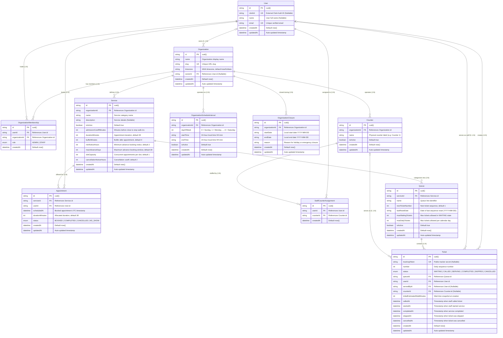

# QueueFlow — Database Architecture & Entity-Relationship Documentation

> Detailed schema specification of QueueFlow's PostgreSQL database models, foreign keys, cardinality, cascading rules, and composite indexes defined in `prisma/schema.prisma`.

---

## 1. Entity-Relationship Diagram



---

## 2. Model Directory & Operational Responsibilities

### 1. `Organization`
The tenant root entity. Represents a physical business, medical facility, university department, or government office. All operational services, counters, schedules, queues, and memberships are scoped to an organization.
- **Timezone Anchor:** Stores an IANA timezone string (`timezone`, default `"Asia/Kolkata"`), enabling localized calendar midnights and DayLight Saving Time (DST) safety across multi-region deployments.

### 2. `User`
The centralized account entity. Represents customers, staff operators, and organization owners.
- **Identity Sync:** Stores optional `clerkId` to link with Clerk external identity management, alongside verified unique `email`.
- **Decoupled Lifecycle:** User accounts are independent of any single organization. If an organization is deleted, user identities remain intact.

### 3. `OrganizationMembership`
Join table establishing tenant access control. Associates a `User` with an `Organization` and assigns an `OrganizationRole` (`ADMIN` or `STAFF`).
- **Owner vs. Admin:** The organization creator is assigned as `Organization.ownerId` and given an `ADMIN` membership record.

### 4. `Service`
Represents a distinct offering or department (e.g., "General Consultation", "Blood Work", "Document Verification").
- **Configuration Hub:** Governs appointment duration (`durationMinutes`), post-service recovery buffer (`bufferMinutes`), advance booking rules (`minNoticeHours`, `maxAdvanceDays`), concurrent slot limits (`slotCapacity`), and walk-in cutoff (`admissionCutoffMinutes`).

### 5. `Queue`
A discrete waiting line belonging to a specific `Service`. Organizations can maintain multiple queues per service (e.g., "Priority Queue", "Standard Walk-In").
- **Sequence State:** Maintains `nextTicketNumber` and `lastResetDate` for atomic sequence allocation and midnight resets.
- **Capacity Gates:** Houses `maxWaitingTickets` (limits active waiting line) and `maxDailyTickets` (limits total throughput per day).

### 6. `Ticket`
Represents an individual walk-in customer's position in a queue.
- **State Machine:** Governed by `TicketStatus`: `WAITING` $\rightarrow$ `CALLED` $\rightarrow$ `SERVING` $\rightarrow$ `COMPLETED` (or terminal `SKIPPED` / `CANCELLED`).
- **Private Tracker:** Secure `trackingToken` enables anonymous or mobile access to live status streams without exposing internal IDs.
- **Audit Timestamps:** Tracks complete lifecycle events (`calledAt`, `startedAt`, `completedAt`, `skippedAt`, `cancelledAt`) used for operational analytics and SLA calculations.

### 7. `Appointment`
Represents a pre-scheduled customer booking for a specific `Service` at a discrete timestamp (`scheduledAt`).
- **Conflict Prevention:** Active statuses (`BOOKED`) occupy slot capacity; terminal statuses (`COMPLETED`, `CANCELLED`, `NO_SHOW`) release capacity.

### 8. `Counter`
Physical service station or desk (e.g., "Counter 1", "Room 102").
- **Operational Availability:** Can be toggled `isActive` by administrators without deleting historical ticket assignment logs.

### 9. `StaffCounterAssignment`
Join model mapping a `User` (staff operator) to a physical `Counter`. Contains fields `id`, `userId`, `counterId`, and `createdAt`. Enforces `@@unique([userId, counterId])` to prevent duplicate assignment records. (Note: The schema models static user-to-counter authorization; it does not contain scheduled shift ranges, dynamic status flags, or active/inactive assignment states).

### 10. `OrganizationScheduleInterval`
Configures weekly recurring business hours. Supports multiple non-overlapping time windows per day (e.g., 09:00–12:30 and 13:30–17:00) using integer day-of-week indexes (`0` = Sunday through `6` = Saturday) and 24-hour time strings (`"HH:mm"`).

### 11. `OrganizationClosure`
Declares exceptional multi-day or single-day closures (national holidays, facility maintenance, emergency shutdowns) using calendar dates (`"YYYY-MM-DD"`). Evaluated prior to standard weekly intervals during slot calculation and ticket admissions.

---

## 3. Relational Constraints & Deletion Cascades

QueueFlow enforces strict referential integrity at the database engine level via PostgreSQL constraints:

| Parent Model | Child Model | Relation Field | Action on Delete | Architectural Rationale |
|---|---|---|---|---|
| `Organization` | `OrganizationMembership` | `organizationId` | **CASCADE** | Deleting a tenant purges all staff/admin associations for that tenant. |
| `Organization` | `Service` | `organizationId` | **CASCADE** | Tenant deletion cleans up all departmental services. |
| `Organization` | `Counter` | `organizationId` | **CASCADE** | Tenant deletion cleans up all physical counters. |
| `Organization` | `OrganizationScheduleInterval` | `organizationId` | **CASCADE** | Tenant deletion removes operating schedule configuration. |
| `Organization` | `OrganizationClosure` | `organizationId` | **CASCADE** | Tenant deletion removes holiday closure calendars. |
| `Service` | `Queue` | `serviceId` | **CASCADE** | Deleting a service cascades to all underlying ticket lines. |
| `Service` | `Appointment` | `serviceId` | **CASCADE** | Deleting a service cascades and permanently deletes all associated appointment records from the database. |
| `Queue` | `Ticket` | `queueId` | **CASCADE** | Deleting a queue purges associated queue tickets. |
| `Counter` | `StaffCounterAssignment` | `counterId` | **CASCADE** | Deleting a counter unbinds staff mappings. |
| `Counter` | `Ticket` | `counterId` | **SET NULL** | Deleting a physical counter preserves ticket history and analytics (`counterId` becomes NULL). |
| `User` | `Ticket (Customer)` | `userId` | **CASCADE** | Deleting a user account deletes tickets created by that customer. |
| `User` | `Ticket (Staff)` | `servedById` | **SET NULL** | Deleting a staff user account preserves ticket service duration history (`servedById` becomes NULL). |
| `User` | `Appointment` | `userId` | **CASCADE** | Deleting a user account removes customer appointments. |
| `User` | `StaffCounterAssignment` | `userId` | **CASCADE** | Deleting a staff user clears counter authorization records. |
| `User` | `Organization` | `ownerId` | **RESTRICT** | **Safety Guard:** Prevents deleting a `User` who is currently registered as an `Organization` owner. The organization must be transferred or deleted first. |

---

## 4. Primary Keys, Unique Constraints & Composite Indexes

### Primary Keys
Every model in the schema utilizes an immutable, collision-resistant CUID string (`@default(cuid())`) as its primary key (`id`).

### Unique Constraints
| Model | Target Column(s) | Constraint Purpose |
|---|---|---|
| `Organization` | `[slug]` | Ensures distinct, URL-friendly public addresses (e.g., `/organizations/apex-clinic`). |
| `User` | `[email]` | Guarantees account uniqueness across verified email addresses. |
| `User` | `[clerkId]` | Prevents duplicate identity mappings to the same Clerk user. |
| `OrganizationMembership` | `[userId, organizationId]` | Prevents a user from having multiple role records in the same tenant. |
| `Service` | `[organizationId, name]` | Prevents duplicate service category names within an organization. |
| `Queue` | `[serviceId, name]` | Prevents duplicate queue names under the same service. |
| `Counter` | `[organizationId, name]` | Prevents duplicate counter identifiers within an organization. |
| `StaffCounterAssignment` | `[userId, counterId]` | Prevents duplicate assignment records between a user and a counter. |
| `Ticket` | `[trackingToken]` | Guarantees private lookup token uniqueness for mobile status tracking. |

### Composite Query Indexes
Performance-critical lookups are accelerated by composite B-Tree indexes defined across the Prisma schema and PostgreSQL migrations:

```sql
-- Ticket queue ordering and staff next-ticket allocation
CREATE INDEX "Ticket_queueId_number_idx" ON "Ticket"("queueId", "number");
CREATE INDEX "Ticket_queueId_status_number_idx" ON "Ticket"("queueId", "status", "number");
CREATE INDEX "Ticket_queueId_createdAt_idx" ON "Ticket"("queueId", "createdAt");

-- Staff operational activity lookups
CREATE INDEX "Ticket_servedById_status_idx" ON "Ticket"("servedById", "status");
CREATE INDEX "Ticket_userId_idx" ON "Ticket"("userId");

-- Standard appointment indexes (prisma/schema.prisma)
CREATE INDEX "Appointment_userId_scheduledAt_idx" ON "Appointment"("userId", "scheduledAt");
CREATE INDEX "Appointment_serviceId_scheduledAt_idx" ON "Appointment"("serviceId", "scheduledAt");
CREATE INDEX "Appointment_userId_scheduledAt_status_idx" ON "Appointment"("userId", "scheduledAt", "status");
CREATE INDEX "Appointment_serviceId_scheduledAt_status_idx" ON "Appointment"("serviceId", "scheduledAt", "status");

-- Partial active appointment indexes (Migration: 20261111210000_add_appointment_scheduling_engine)
-- Partial indexes filter out CANCELLED rows, optimizing conflict detection and slot availability queries:
CREATE INDEX "Appointment_serviceId_scheduledAt_active_idx" ON "Appointment"("serviceId", "scheduledAt") WHERE "status" <> 'CANCELLED';
CREATE INDEX "Appointment_userId_scheduledAt_active_idx" ON "Appointment"("userId", "scheduledAt") WHERE "status" <> 'CANCELLED';

-- Localized schedule evaluations and date-range closure lookups
CREATE INDEX "OrganizationScheduleInterval_organizationId_dayOfWeek_idx" ON "OrganizationScheduleInterval"("organizationId", "dayOfWeek");
CREATE INDEX "OrganizationClosure_organizationId_startDate_endDate_idx" ON "OrganizationClosure"("organizationId", "startDate", "endDate");
```

