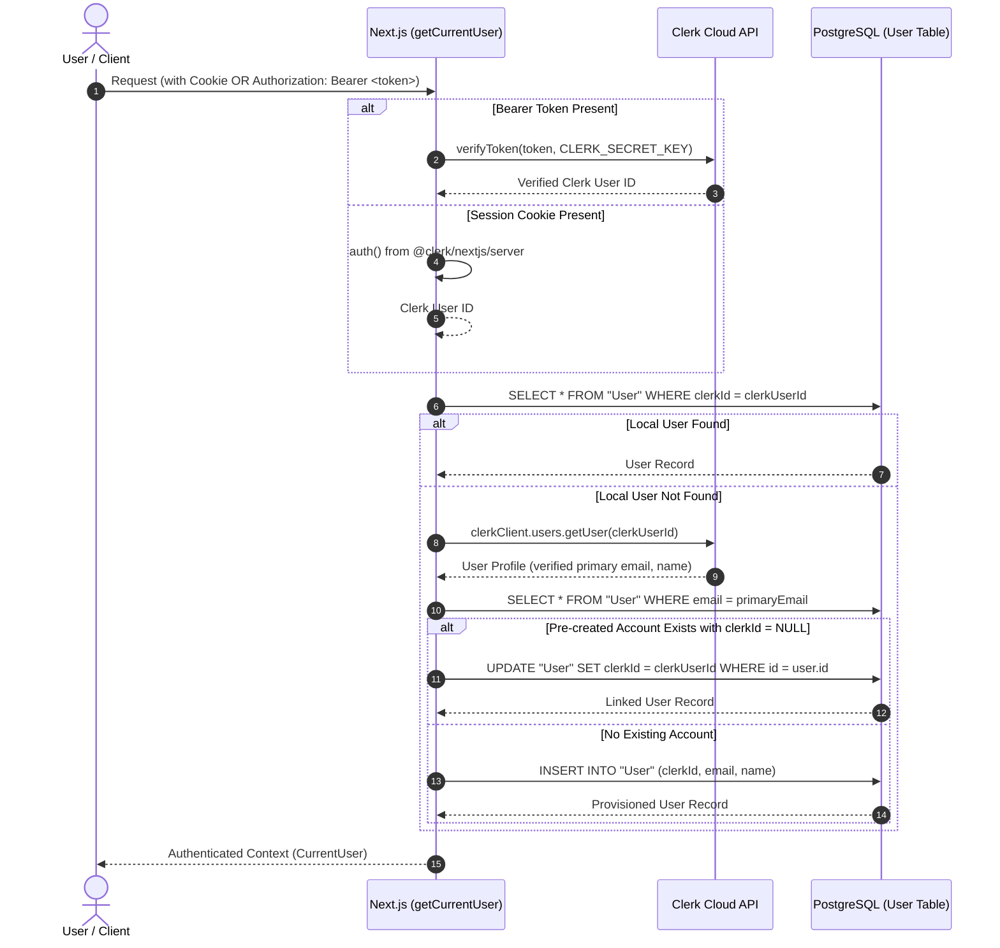
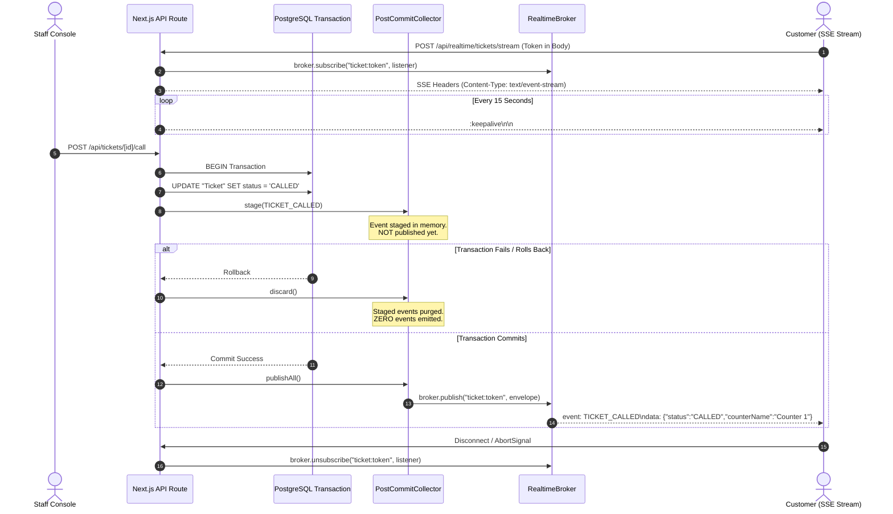
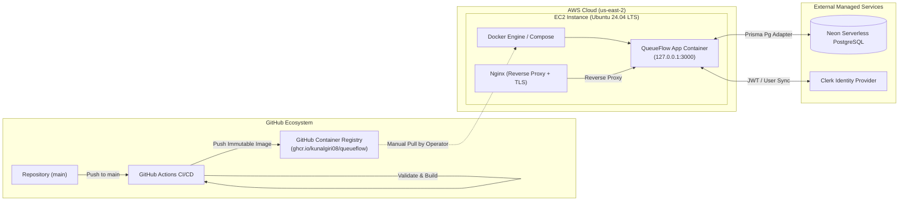

# QueueFlow — System Architecture & Engineering Design

> Comprehensive technical specification of QueueFlow's runtime architecture, data flows, real-time streaming engine, and deployment infrastructure.

---

## 1. High-Level System Architecture

QueueFlow follows a multi-tier SaaS architecture designed for high-concurrency queue operations, predictable transaction boundaries, and low-latency real-time client synchronization.

```mermaid
flowchart TD
    subgraph Clients["Client Tier"]
        CUST["Customer Device<br/>(Mobile / Desktop Browser)"]
        STAFF["Staff Console<br/>(Service Point Interface)"]
        ADMIN["Admin Dashboard<br/>(Management & Analytics)"]
    end

    subgraph HostEdge["Host Edge Tier (AWS EC2)"]
        NGINX["Nginx Reverse Proxy & TLS Terminator<br/>(:80 / :443)"]
    end

    subgraph AppTier["Application Tier (Docker Container)"]
        STANDALONE["Next.js 16 Standalone Server<br/>(Node.js 24 LTS, :3000)"]
        
        subgraph AppLayers["Layered Architecture"]
            ROUTES["Route Handlers (app/api/**)"]
            VALIDATION["Zod Validation Layer"]
            AUTH_LAYER["Clerk Auth & User Provisioning"]
            
            subgraph Services["Core Domain Services"]
                SVC_TICKET["TicketService<br/>(Atomic Sequences & Limits)"]
                SVC_APPT["AppointmentService<br/>(Dynamic Slot Calculation)"]
                SVC_SCHED["ScheduleService<br/>(Timezone & Closures)"]
                SVC_PRED["PredictionService<br/>(Rolling Average Wait Time)"]
            end
            
            subgraph RealtimeSubsystem["Realtime Subsystem"]
                POST_COMMIT["PostCommitCollector<br/>(Staged Transaction Hook)"]
                BROKER["RealtimeBroker<br/>(Process-Local In-Memory Pub/Sub)"]
            end
            
            PRISMA["Prisma ORM 7 + Driver Adapter<br/>(@prisma/adapter-pg + pg)"]
        end
    end

    subgraph Persistence["Persistence & Identity"]
        NEON[("Neon Serverless PostgreSQL<br/>(Pooled & Direct Ports)")]
        CLERK["Clerk Authentication Cloud<br/>(Identity Provider)"]
    end

    %% Network flows
    CUST -->|HTTPS / SSE| NGINX
    STAFF -->|HTTPS / SSE| NGINX
    ADMIN -->|HTTPS| NGINX

    NGINX -->|HTTP (127.0.0.1:3000)| STANDALONE
    STANDALONE --> ROUTES
    ROUTES --> VALIDATION
    ROUTES --> AUTH_LAYER
    AUTH_LAYER <-->|JWT Verification & User API| CLERK

    ROUTES --> Services
    Services --> PRISMA
    Services --> POST_COMMIT
    POST_COMMIT -->|After Transaction Commit| BROKER
    BROKER -->|text/event-stream chunks| STANDALONE
    PRISMA <-->|PostgreSQL Protocol| NEON
```

---

## 2. Ingress & Request Lifecycle

```
[ Client Request ]
       │
       ▼
[ Nginx (Host: EC2) ]
   ├── Terminates TLS (Certbot Let's Encrypt)
   ├── Enforces security headers (X-Frame-Options, X-Content-Type-Options)
   ├── Routes standard HTTP traffic to http://127.0.0.1:3000 with connection keep-alive
   └── Routes /api/realtime/ with proxy_buffering off and extended read timeout (proxy_read_timeout 86400s; keepalive heartbeats every 15s)
       │
       ▼
[ Next.js 16 Standalone Server (:3000) ]
   ├── Middleware: Route matching & security headers
   ├── Route Handler (`app/api/**/route.ts`)
   │    ├── 1. Request parsing & Zod schema validation
   │    ├── 2. Authentication & tenant authorization
   │    ├── 3. Service invocation with Prisma transaction
   │    ├── 4. Post-commit event staging
   │    └── 5. Transaction commit & immediate in-memory event dispatch
   ▼
[ Response JSON / SSE Stream ]
```

### Nginx Reverse Proxy Configuration
The host-level Nginx reverse proxy routes all inbound traffic to the containerized application listening strictly on loopback (`127.0.0.1:3000`):

1. **Standard API & Page Requests:** Proxied using HTTP/1.1 with connection reuse.
2. **Real-Time SSE Streams (`/api/realtime/`):** Configured with `proxy_buffering off`, `proxy_cache off`, and `chunked_transfer_encoding off` to guarantee that event chunks are pushed to the client socket instantaneously without proxy-level buffering delays.

---

## 3. Authentication & Authorization Flow

Authentication is managed via **Clerk**, decoupled from local database storage, and synchronized on-demand.



### Account Linking Security Guarantees
- **Verified Primary Email Only:** Accounts are provisioned or linked strictly using email addresses verified by Clerk (`verification.status === "verified"`).
- **Anti-Takeover Invariant:** If an existing local `User` record already has a non-null `clerkId` that differs from the requesting user, the system refuses to link, preventing identity hijacking.
- **Role Scoping:** Roles (`ADMIN`, `STAFF`) are stored in `OrganizationMembership` and verified on every protected API invocation. Organization deletion cascades memberships but preserves `User` identities.

---

## 4. Layered Application Structure & Responsibilities

```
app/api/                     --> Presentation & Transport Layer (Route Handlers)
  ├── Input extraction
  ├── Zod validation enforcement
  ├── Auth & tenant role checks
  └── Serialization & status mapping
          │
          ▼
lib/services/                --> Domain Logic Layer (Pure Business Rules & DB Ops)
  ├── ticket.service.ts      --> Atomic sequence generation, capacity constraints
  ├── appointment.service.ts --> Candidate slot calculation, buffer/notice rules
  ├── schedule.service.ts    --> Operating hours evaluation, IANA timezone resolution
  └── prediction.service.ts  --> Rolling-window wait time estimation
          │
          ▼
lib/realtime/                --> Event Notification Subsystem
  ├── post-commit.ts         --> Transaction-aware stage & publish coordinator
  └── broker.ts              --> Process-local pub/sub channel registry
          │
          ▼
lib/prisma.ts                --> Persistence Layer (Prisma ORM 7 + Driver Adapter)
  └── Neon PostgreSQL (pg pool, transaction rollback/commit boundaries)
```

### Separation of Concerns
1. **Route Handlers (`app/api/`):** Thin orchestrators. They never execute raw SQL, never directly compute candidate appointment slots, and never publish events directly to the broker.
2. **Validation Layer (`lib/validations/`):** Reusable Zod schemas defining strict input boundaries (e.g., regex-validated slugs, IANA timezone names, integer ranges).
3. **Domain Services (`lib/services/`):** Encapsulate all database queries, locking strategies, and time calculations. All state-mutating service methods operate inside or accept a Prisma `TransactionClient`:
   - `ticket.service.ts`: Atomic sequence allocation, daily resets, queue capacity limits, and stale ticket resolution.
   - `appointment.service.ts`: Candidate slot generation, buffer and notice enforcement, and slot capacity validation.
   - `schedule.service.ts`: Timezone-aware operating hours evaluation and exceptional holiday/emergency closures.
   - `prediction.service.ts`: Functional wait time estimation (`estimateTicketWaitTime`, `calculateEstimatedWaitMinutes`). Implements a rolling-average duration model sampling up to 10 completed tickets (`DEFAULT_HISTORY_WINDOW_SIZE = 10`) from the current local calendar day, filtering cross-day anomalies, adding the estimated remaining duration of the active ticket, and falling back to a 5-minute baseline when historical data is sparse.
4. **Data Access Layer (`lib/prisma.ts`):** Utilizes `@prisma/adapter-pg` with a pooled connection string for application runtime queries, guaranteeing efficient socket reuse under high throughput.

---

## 5. PostgreSQL as the Single Source of Truth & Concurrency Control

QueueFlow deliberately avoids distributed external lock managers (e.g., Redis Redlock) by leveraging PostgreSQL's native ACID transaction semantics:

### 1. Atomic Ticket Sequence Numbering
To eliminate sequence collisions during simultaneous ticket creations, QueueFlow utilizes a single atomic PostgreSQL update query:

```sql
UPDATE "Queue"
SET
  "nextTicketNumber" = CASE
    WHEN "lastResetDate" IS NULL OR "lastResetDate" != $1 THEN 2
    ELSE "nextTicketNumber" + 1
  END,
  "lastResetDate" = $1
WHERE "id" = $2 AND "isActive" = true
RETURNING "nextTicketNumber" - 1 AS number;
```

- **Guarantees:** Monotonic, strictly incrementing integers starting at 1 each local calendar day.
- **Zero Race Conditions:** The row lock acquired by the `UPDATE` ensures serialized sequence allocation without application-level mutexes.

### 2. Fair Ticket Calling via `FOR UPDATE SKIP LOCKED`
When a staff member calls the next waiting ticket (`PATCH /api/queues/[id]/next`), concurrent requests across staff members and counters are handled safely within a transactional sequence:
1. **Serialize Staff Invocations:** The calling staff user's record is locked using `SELECT "id" FROM "User" WHERE "id" = $1 FOR UPDATE`, serializing rapid concurrent calls by the same operator across counters.
2. **Stale Ticket Reconciliation:** The system resolves any uncompleted or stale tickets left open from prior calendar days for both the queue (`resolveStaleQueueTickets`) and the staff operator (`resolveStaleStaffActiveTickets`).
3. **Single Active Ticket Enforcement:** Checks that the staff member does not already have an active ticket in `CALLED` or `SERVING` state (`STAFF_HAS_ACTIVE_TICKET`).
4. **Concurrency-Safe Ticket Selection (`SKIP LOCKED`):** The next eligible ticket is claimed via:
   ```sql
   SELECT "id" FROM "Ticket"
   WHERE "queueId" = $1 AND "status" = 'WAITING' AND "createdAt" >= $2
   ORDER BY "number" ASC, "createdAt" ASC
   LIMIT 1
   FOR UPDATE SKIP LOCKED;
   ```
   Using `SKIP LOCKED` prevents lock contention and race conditions when multiple staff operators at different counters call tickets simultaneously from the same queue.
5. **Atomic Claim:** Updates the claimed ticket to `status = 'CALLED'`, binding `counterId`, `servedById`, and `calledAt = now()`.

### 3. Slot Capacity Protection via Ordered Row-Level Locks
Appointment bookings (`POST /api/appointments`) prevent double-booking under high concurrency using interactive Prisma transactions with strict lock hierarchy:
1. **User Lock:** Locks the customer's record (`SELECT "id" FROM "User" WHERE "id" = $1 FOR UPDATE`), preventing concurrent duplicate submissions by the same user.
2. **Service Lock:** Locks the service record (`SELECT "id", "isActive" FROM "Service" WHERE "id" = $2 FOR UPDATE`), serializing concurrent booking attempts for that specific service.
3. **Lock Ordering:** Enforcing the `User` $\rightarrow$ `Service` acquisition sequence prevents database deadlocks.
4. **Capacity Check Under Lock:** Inside the locked transaction, `checkSlotCapacityAndConflicts` counts active (`status <> 'CANCELLED'`) appointments overlapping the requested slot and ensures count does not exceed `Service.slotCapacity` prior to insertion.

---

## 6. Real-Time Streaming Architecture (SSE)

QueueFlow uses unidirectional Server-Sent Events (SSE) over persistent HTTP connections instead of full-duplex WebSockets, providing native browser reconnection, proxy friendliness, and zero socket protocol overhead.



### Architectural Properties of the Realtime Subsystem
1. **Channel Namespaces:**
   - `ticket:${trackingToken}`: Customer-specific private ticket updates.
   - `customer:queue:${queueId}`: Public queue length / status invalidations.
   - `org:${organizationId}`: Organization-wide staff activity stream.
   - `queue:${queueId}`: Queue-specific staff activity stream.
2. **Zero URL Credential Leakage:** The customer SSE endpoint accepts `POST` with the tracking token supplied in the request body (`POST /api/realtime/tickets/stream`), ensuring tracking secrets never appear in server access logs, browser history, or proxy logs.
3. **Strict Payload Sanitization:** Customer-facing events are stripped of all PII, staff IDs, and database keys. Only sanitized fields (`ticketNumber`, `status`, `counterName`) are transmitted.
4. **Heartbeats & Auto-Reconnection:** Streams emit `:keepalive\n\n` comments every 15 seconds to prevent intermediate proxy timeouts. If disconnected, clients reconnect with exponential backoff and execute adaptive fallback polling (every 10s–30s).
5. **Process-Crash Boundary:** Events are dispatched in-memory immediately following successful database commit. The PostgreSQL database remains the absolute source of truth; clients reconcile state via fallback queries if a process crashes before in-memory dispatch.

---

## 7. Core Workflows

### 7.1 Virtual Ticket Creation Flow (Walk-In)
```
1. Customer views service page -> selects queue.
2. Client submits POST /api/public/.../tickets.
3. Route checks organization operating hours and exceptional closures.
4. Route checks service admission cutoff window (minutes before closing).
5. Route checks queue capacity limits (maxWaitingTickets & maxDailyTickets).
6. TicketService executes atomic UPDATE on Queue to allocate monotonic number.
7. Ticket record created with crypto-random trackingToken and WAITING status.
8. PostCommitCollector stages TICKET_CREATED.
9. DB transaction commits.
10. Event dispatched to staff and queue channels.
11. Response returns ticket number and private trackingToken.
```

### 7.2 Appointment Scheduling & Booking Flow
```
1. Customer requests available slots: GET /api/public/.../slots?date=YYYY-MM-DD.
2. AppointmentService validates IANA timezone and checks calendar closures.
3. Service extracts active schedule intervals for the weekday.
4. Candidate slots generated: Tk = startTime + k * (durationMinutes + bufferMinutes).
5. Slots extending beyond operating block or closing time are rejected.
6. Slots violating minNoticeHours (too soon) or maxAdvanceDays (too far) are filtered.
7. Active appointments overlapping each slot are counted and checked against slotCapacity.
8. Customer submits POST /api/appointments for chosen slot.
9. Transaction re-verifies slot capacity under lock to prevent double-booking.
10. Appointment record created with BOOKED status.
```

---

## 8. Production Deployment & Infrastructure



### CI vs. Deployment Separation
- **Continuous Integration & Packaging (Automated):** GitHub Actions triggers on every pull request and push to `main`. It validates linting, static type analysis, the 125 test suites, and Docker container builds. On pushes to `main`, it builds and publishes signed, immutable image tags to GitHub Container Registry (`ghcr.io/kunalgiri08/queueflow`).
- **EC2 Deployment (Manual):** Deployment to the AWS EC2 production virtual machine is executed **manually** by an operator. There is **no automated Continuous Deployment (CD) agent, runner, or webhook**. The operator connects via SSH, exports `/root/queueflow.env`, runs pending migrations via `npx prisma migrate deploy --config prisma7.config.ts`, pulls the new image tag, and restarts the container via `docker compose up -d`.

### Containerization Strategy (`Dockerfile`)
- **Base Image:** `node:24-alpine` for minimal attack surface and small image footprint (~180MB).
- **Multi-Stage Build:**
  - `deps`: Installs production dependencies and generates Prisma Client (`prisma generate`).
  - `builder`: Validates build-time environment variables, compiles Next.js with standalone output.
  - `runner`: Unprivileged runtime execution using system user `nextjs:nodejs` (UID 1001).
- **Built-In Container Healthcheck:**
  ```dockerfile
  HEALTHCHECK --interval=15s --timeout=3s --start-period=10s --retries=3 \
    CMD wget -qO- http://127.0.0.1:3000/api/health?probe=live > /dev/null || exit 1
  ```
- **Port Isolation:** Container port 3000 is bound strictly to `127.0.0.1:3000` via Docker Compose, preventing direct internet exposure bypassing Nginx.

---

## 9. Architectural Decisions & Engineering Trade-Offs

| Decision | Alternative Considered | Rationale & Trade-Off |
|---|---|---|
| **Server-Sent Events (SSE)** | WebSockets | **Chosen:** SSE provides native browser auto-reconnect, operates over standard HTTP/1.1, and traverses corporate proxies seamlessly without duplex connection state. **Trade-off:** Unidirectional; client actions (join, cancel) use standard REST POST endpoints. |
| **Process-Local Event Broker** | Redis / Kafka | **Chosen:** Zero external infrastructure dependencies for single-instance deployments; ultra-fast in-memory dispatch. **Trade-off:** Scoped to single container instance; horizontal scaling across multiple container replicas requires external message broker (Redis Pub/Sub). |
| **PostgreSQL Atomic Sequence Generation** | Redis Distributed Locks | **Chosen:** Leverages PostgreSQL's single-statement row lock (`UPDATE ... RETURNING`), eliminating distributed lock contention, network hops, and deadlocks. **Trade-off:** Database handles sequence allocation load. |
| **Post-Commit Hook Architecture** | Transactional Outbox Pattern | **Chosen:** Simplifies architecture with zero extra database polling workers or outbox tables while guaranteeing zero phantom events on rollbacks. **Trade-off:** Microsecond crash window between DB commit and process execution (reconciled by clients via safety polling). |
| **Timezone-Aware Schedule Engine** | UTC-Only Storage & Eval | **Chosen:** Operating hours and daily sequence resets evaluate local calendar midnights per organization IANA timezone, ensuring full Daylight Saving Time (DST) safety across 23h/25h transition days. |

